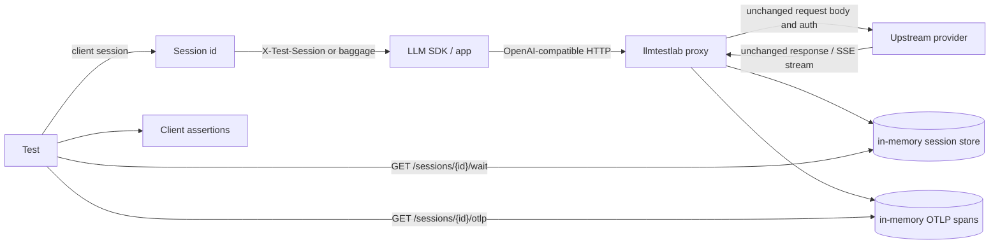

# llm-test-lab

Deterministic, trace-based integration testing for LLM apps, without an LLM judge.

`llm-test-lab` is a Go reverse proxy. Put it between your app and an
OpenAI-compatible provider, run the real SDK call, then assert on the recorded
trace: tool names, tool arguments, tool order, request parameters, finish
reasons, token usage, retries, latency, TTFT, and provider errors.

Clients live in separate repositories and download or run this proxy binary.

## 60-second quickstart

Install the proxy binary from a GitHub release, or install from source:

```bash
go install github.com/barzoj-co/llm-test-lab/cmd/llmtestlab@latest
```

Run the proxy against OpenAI:

```bash
llmtestlab \
  --listen 127.0.0.1:7777 \
  --control 127.0.0.1:7778 \
  --upstream openai=https://api.openai.com/v1
```

Then drive tests through a client in one of the [client repositories](#clients).
The Go client lives in [`llm-test-lab-go`](https://github.com/barzoj-co/llm-test-lab-go)
and tags requests with `X-Test-Session`:

```go
package myapp_test

import (
    "context"
    "os"
    "testing"

    llmtestlab "github.com/barzoj-co/llm-test-lab-go"
    "github.com/openai/openai-go"
    "github.com/openai/openai-go/option"
)

func TestWeatherTool(t *testing.T) {
    lab := llmtestlab.New(t)

    client := openai.NewClient(
        option.WithAPIKey(os.Getenv("OPENAI_API_KEY")),
        option.WithBaseURL(lab.OpenAIBaseURL("openai")), // http://127.0.0.1:7777/u/openai
        option.WithHTTPClient(lab.HTTPClient()),         // injects X-Test-Session
        option.WithMaxRetries(0),
    )

    // Drive your real app/agent. It should use the OpenAI client above and its
    // normal tool schema/configuration.
    if err := RunWeatherAgent(context.Background(), client, "Weather in Paris?"); err != nil {
        t.Fatal(err)
    }

    assert := lab.Expect(context.Background())
    assert.CallCount(1)
    assert.ToolCalled("get_weather", llmtestlab.ArgsSubset(map[string]any{"city": "Paris"}))
    assert.NoRetries()
    assert.NoErrors()
    assert.TokensBelow(1000)
}
```

Run your Go test (from a project that depends on the Go client):

```bash
OPENAI_API_KEY=sk-... go test ./...
```

## Clients

This repository ships only the proxy. Use these client libraries against it:

- [Go](https://github.com/barzoj-co/llm-test-lab-go)
- [Python](https://github.com/barzoj-co/llm-test-lab-python)
- [JS/TS](https://github.com/barzoj-co/llm-test-lab-js)

## How it works



The proxy forwards the provider protocol unchanged. It records a tee copy, parses
OpenAI-wire calls when it can, and leaves everything else as raw passthrough.

## Features

- Reverse proxy binary: `cmd/llmtestlab`.
- Named upstreams, including `/u/{name}/...` routing and bare-path routing for a single
  upstream or a `default` upstream.
- OpenAI Chat Completions parser for streaming and non-streaming responses.
- OpenAI Responses parser for streaming and non-streaming responses.
- Azure OpenAI paths with dated `api-version` query strings, deployment extraction, and
  `/openai/v1`-style OpenAI-compatible URLs.
- OpenRouter/OpenAI-compatible stream tolerance, including keep-alive comments and final
  usage chunks.
- Raw passthrough recording for unrecognized APIs.
- Per-test sessions via `X-Test-Session` or W3C baggage.
- Control API for health, session fetch, wait-until-quiet, OTLP/JSON export, and delete.
- Secret redaction in recorded headers and selected URL query parameters.
- Clients (separate repos) with trace queries and assertions for tools, JSON args, retries,
  errors, usage, response content, latency, and TTFT.
- One in-memory OTel CLIENT span per proxied attempt, using stable HTTP attributes plus
  pinned GenAI attributes.

## Documentation

- [Proxy configuration and control API](docs/proxy.md)
- [Provider compatibility and SDK wiring](docs/providers.md)
- [Recorded trace data model](docs/data-model.md)
- [OTel GenAI mapping](docs/otel.md)
- [GitHub Actions / CI](docs/ci.md)
- [Troubleshooting](docs/troubleshooting.md)
- [Contributing](CONTRIBUTING.md)

## License

Licensed under [AGPL-3.0](LICENSE).

## Status and roadmap

This repo contains the Go proxy only. The session store and OTLP span store are
in memory. Clients live in their own repos (see [Clients](#clients)).

Planned in later versions of the proxy:

- Anthropic Messages parsing in v2.
- External OTLP export and stricter content-capture controls.
- Record/replay cassettes, fault injection, packaging polish, and local TLS.

The current `--tls` flag is parsed by the CLI but is not wired to any TLS listener.
