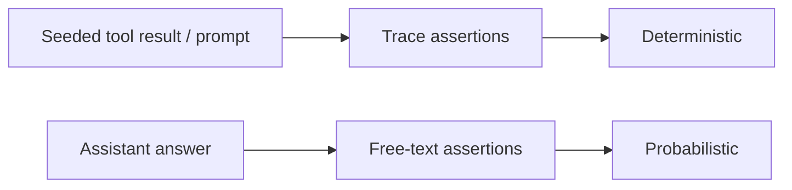

# Assertions: trace vs free text

The product rule, confirmed on live dogfood runs (healsens chatservice and
livekit-demo): assertions on what the system **sent and received** (the
recorded trace) are deterministic. Assertions on what the model **wrote**
are probabilistic.

Client helpers live in [llmentary-go](https://github.com/barzoj-co/llmentary-go),
[llmentary-python](https://github.com/barzoj-co/llmentary-python), and
[llmentary-js](https://github.com/barzoj-co/llmentary-js). The pytest fixture
and the JS export are `llmentary`. Example variables are `lm`. How to attribute
calls from an unmodified service is in [Black-box and sidecar setups](black-box.md).

## Layers

1. **Trace structure** — call count and order, tools offered and called,
   arguments, tool results fed back, request parameters, finish reasons,
   retries, HTTP status, spec violations. Deterministic. Use freely.
2. **Content that flowed through the trace** — `prompt_contains` on tool
   results, system prompt, and history that *your test seeded*. Deterministic
   given those fixtures (the bytes went back on the wire).
3. **The model's free text** — the assistant's answer. Probabilistic. Use
   sparingly. Assert on values the model will naturally repeat, not on
   sentinel tokens you never asked it to echo.



## Seeding

Put exact sentinel tokens (`SEED_…`) in **tool results** (or other fixture
bytes the app will send back) and assert them on the **trace**:
`prompt_contains("SEED_Cardiovascular_Risk")` on the follow-up request,
`tool_result_fed_back`, or `tool_result_in_prompt("get_risks")`.

For the answer, seed distinctive **natural** values the model is likely to
copy (`41.3`, `20 °C`, `ten minutes`, `moderate`) and match them with a
tolerant helper (`answer_mentions_any` / `MentionsAny` / `mentionsAny`:
casefold, optional number normalization). Do not require the `SEED_…`
string in the answer.

## Worked examples

Excerpts are redacted. No API keys.

### healsens chatservice (live run 2)

Trace checks all passed: the right tools were offered, `get_user_biological_age`
was not, `get_risks` and `get_user_health_tips` were called, their results were
fed back, `SEED_Cardiovascular_Risk` and `SEED_Tip_Walk_After_Meals` were in
the captured follow-up **request**, streaming was on, `spec_violations` was
empty.

The only failures were substring checks on the final answer. The model
paraphrased the seeded titles:

```text
answer="… 2. **Cardiovascular Risk**: You have a moderate cardiovascular risk. …"
# expected SEED_Cardiovascular_Risk

answer="… - **Walk After Meals**: It's recommended to walk for ten minutes after each meal. …"
# expected SEED_Tip_Walk_After_Meals
```

Before (flaky):

```python
assert "SEED_Cardiovascular_Risk" in answer
assert "SEED_Tip_Walk_After_Meals" in answer
```

After (trace deterministic, answer tolerant):

```python
lm.expect().tool_result_in_prompt("get_risks")
lm.expect().prompt_contains("SEED_Cardiovascular_Risk")
lm.expect().final_response_mentions_any("moderate", "41.3")
# answer_mentions_any(answer, "ten minutes", "walk", normalize_numbers=True)
```

### livekit-demo weather turn

Exact checks belong on the trace: `function_call_output` equals the Lua JSON,
args are `Amsterdam` / `celsius`, exactly three calls. The answer check is
deliberately loose ("mentions 20 or sunny").

```go
assert := lm.Expect(ctx)
assert.CallCount(3)
assert.ToolCalled("get_weather", llmentary.ArgsSubset(map[string]any{
    "city": "Amsterdam", "unit": "celsius",
}))
assert.NoErrors()
// answer: llmentary.MentionsAny(text, "20", "sunny")
```

## Anti-patterns

- Asserting exact wording of the assistant message.
- Asserting a `SEED_…` token in the answer when the prompt never asked the
  model to repeat that token.
- Cumulative-session assertions in a multi-turn test (`lm.expect()` sees
  every call so far). Use a turn checkpoint from the black-box helpers:
  `mark = lm.mark()` / `m := lm.Mark(ctx)` / `const m = await lm.mark()`,
  then `lm.expect(since=mark)` / `lm.Expect(ctx, llmentary.Since(m))` /
  `lm.expect({ since: m })`.
- Treating `response_contains` as a trace check. It is layer 3.

## Optional client helpers

Same names and semantics in all three clients (land in the client repos):

| Check | Go | Python | JS |
|---|---|---|---|
| Plain-text any-of (often the app API, not the trace) | `llmentary.MentionsAny(text, candidates...)` | `answer_mentions_any(text, *candidates, normalize_numbers=True, casefold=True)` | `mentionsAny(text, candidates, opts)` |
| Last recorded `output_text` | `expect.FinalResponseMentionsAny(...)` | `expect().final_response_mentions_any(*candidates)` | `expect({}).finalResponseMentionsAny(...)` |
| Next request after tool X carries X's result verbatim | `expect.ToolResultInPrompt(name)` | `expect().tool_result_in_prompt(name)` | `expect({}).toolResultInPrompt(name)` |

`MentionsAny` is not trace-bound: the answer often comes from the app's HTTP
API. Failure text lists the candidates and a short excerpt (about 200
characters), not request headers or secrets.

Soft mode: Python `expect(soft=True)` collects failures and reports them
together. Go `Check` and the JS client do the same collect-then-fail. Prefer
that over a hand-rolled `_SoftFailures` list.

Existing `response_contains` / `response_regex` / `response_json_schema`
semantics are unchanged. Use them for layer 3 only.

## Semantic checks

If you need "does this answer mean the same thing?" that is LLM-as-judge
(or another evaluator), a separate layer, out of llmentary's scope. llmentary
records the trace so those judges have grounded inputs; it does not score
free text.
