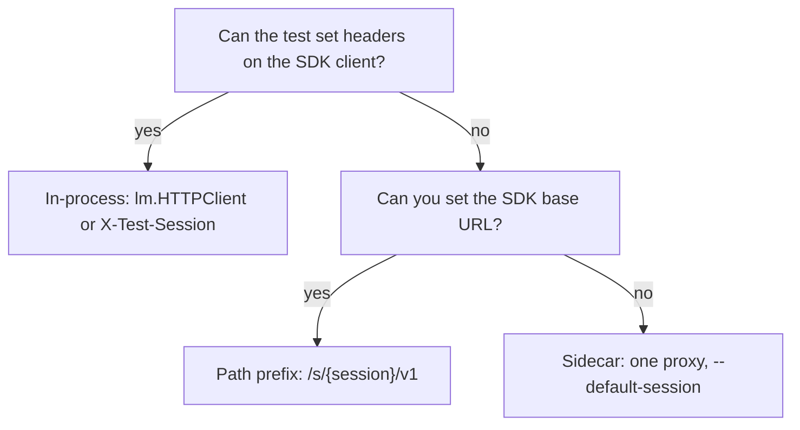

# Black-box and sidecar setups

Use this when the process under test cannot (or should not) take an
`X-Test-Session` header. The recording proxy is the same binary as the
in-process recipe; only how the session is chosen changes.

Client helpers live in [llmentary-go](https://github.com/barzoj-co/llmentary-go),
[llmentary-python](https://github.com/barzoj-co/llmentary-python), and
[llmentary-js](https://github.com/barzoj-co/llmentary-js). The pytest fixture and
the JS export are `llmentary`. Example variables are `lm`.

What to assert afterward is in [Assertions: trace vs free text](assertions-guide.md).
Flags, wait parameters, and the control API are in [Proxy](proxy.md). How to get
the binary is in [Binaries](binaries.md).

## When to use which mode



| Mode | When | How the session is chosen |
|---|---|---|
| In-process | The test constructs the SDK client | `X-Test-Session` via `lm.HTTPClient()` (Go), the `llmentary` fixture (Python), or `llmentary()` (JS) |
| Path prefix | You control the worker's base URL, including import-time / startup clients | `{proxy}/s/{session}/v1` — helpers `lm.PathBaseURL()`, `lm.path_base_url()`, `lm.pathBaseURL()` |
| Sidecar | A compose graph or one proxy per system; workers are unmodified | `--default-session` (default id `default`) on the proxy |

`--session-from` defaults to `header,baggage,path,default`. A path prefix composes
with a named upstream: `/s/{session}/u/{name}/...`. Session ids are one path
segment (percent-decoded, no `/`). After `/s` and `/u` are stripped, unknown first
segments are a local `404` and are not forwarded. See [Session attribution](proxy.md#session-attribution).

## docker compose override

There is no published llmentary image in this repository. Drop a [release
binary](binaries.md) into the project (npm platform package, PyPI wheel, or
GitHub Release) and mount it. Clients that start the proxy for you use the same
artifacts.

```yaml
# compose.llmentary.yaml
services:
  llmentary:
    image: alpine:3.20
    volumes:
      - ./llmentary:/usr/local/bin/llmentary:ro
    command:
      - llmentary
      - --listen
      - 0.0.0.0:7777
      - --control
      - 0.0.0.0:7778
      - --control-token
      - ${LLMENTARY_CONTROL_TOKEN}
      - --default-session
      - svc
    environment:
      LLMENTARY_CONTROL_TOKEN: ${LLMENTARY_CONTROL_TOKEN}
    healthcheck:
      test:
        - CMD-SHELL
        - wget -qO- --header="Authorization: Bearer $$LLMENTARY_CONTROL_TOKEN" http://127.0.0.1:7778/healthz
      interval: 5s
      timeout: 2s
      retries: 12
    expose:
      - "7777"
      - "7778"
  worker:
    environment:
      OPENAI_BASE_URL: http://llmentary:7777/v1
      OPENAI_API_KEY: ${OPENAI_API_KEY}
```

`GET /healthz` is on the **control** listener and, like every other control
route, requires `Authorization: Bearer <token>` when `--control-token` is set.
A non-loopback control bind (`0.0.0.0:7778`) refuses to start without a token.

Point workers at the **proxy** listener (`:7777`), not the control port. With
`--default-session=svc`, untagged calls land on session `svc`.

Check that the worker hit the proxy:

```bash
curl -sS -H "Authorization: Bearer $LLMENTARY_CONTROL_TOKEN" \
  http://127.0.0.1:7778/sessions
```

Wait for an async graph (at least two finished calls, 30s budget):

```bash
curl -sS -H "Authorization: Bearer $LLMENTARY_CONTROL_TOKEN" \
  'http://127.0.0.1:7778/sessions/svc/wait?min_calls=2&timeout=30s&quiet=500ms'
```

Reset between tests (`204` even if the id was never recorded):

```bash
curl -sS -D - -o /dev/null -X DELETE \
  -H "Authorization: Bearer $LLMENTARY_CONTROL_TOKEN" \
  http://127.0.0.1:7778/sessions/svc
```

Validate the override with `docker compose -f compose.yaml -f compose.llmentary.yaml config`
before you run it.

## SDK base-URL environment variables

Set these to the **path-prefixed** proxy URL when the app builds its client at
import or startup. Construction-time reads are the common case; import-time
reads need the env set before the module loads.

| SDK | Variable | When it is read | Verified |
|---|---|---|---|
| openai-go v3 | `OPENAI_BASE_URL` | `DefaultClientOptions()` inside `NewClient` | not verified in this repo (livekit-demo construction-time) |
| openai-python | `OPENAI_BASE_URL` | client construction (`OpenAI()`) | not verified in this repo |
| openai-node | `OPENAI_BASE_URL` | client construction (`new OpenAI()`) | not verified in this repo |
| LangChain `ChatOpenAI` | `base_url=` argument, or `OPENAI_API_BASE` / `OPENAI_BASE_URL` | construction | not verified in this repo |
| Custom wrapper (hard-coded URL) | none | n/a — add a hook or constructor argument | not verified; chatservice `ChatOpenRouter` needed an app hook |

Helpers produce the path prefix (and percent-encode the session id):

| Client | Helper | Example |
|---|---|---|
| Go | `lm.PathBaseURL()` / `lm.PathBaseURL("openrouter")` | `{proxy}/s/t1/v1`, `{proxy}/s/t%201/u/openrouter` |
| Python | `lm.path_base_url()` / `lm.path_base_url("openrouter")` | same |
| JS | `lm.pathBaseURL()` / `lm.pathBaseURL("openrouter")` | same |

`lm.OpenAIBaseURL("openai")` remains the in-process named-upstream URL
(`{proxy}/u/openai`) and does **not** insert `/s/{session}`.

## What a path prefix isolates

A path prefix is chosen by whoever **builds** the SDK client. With the default
`header,baggage,path,default` order, a header or baggage value takes precedence
over `/s/{session}`. The proxy does not split conversations inside one
process that already constructed a single client.

One process with one env-configured client (`OPENAI_BASE_URL` set once, typical
`NewClient` / `OpenAI()`) is **one session**. For N parallel conversations use
one of:

1. **One worker process per session.** The livekit compose pattern: a second
   runtime with its own `OPENAI_BASE_URL`.

   ```yaml
   runtime-b:
     environment:
       OPENAI_BASE_URL: http://llmentary:7777/s/barge/v1
       KAFKA_TOPIC: conversation-b
   ```

2. **Construct the SDK client per conversation** with
   `base_url=lm.path_base_url()` (Go `lm.PathBaseURL()`, JS `lm.pathBaseURL()`).
   Those helpers use the session already stored on `lm`; they do not allocate a
   new one. Use a distinct `lm` (or session id) per conversation.

3. **Headers or baggage from the app** when it can set them (see
   [Session attribution](proxy.md#session-attribution)).

4. **Run conversations sequentially** and `DELETE /sessions/{id}` between them.

Bus-driven systems: a second worker needs its own topic or partition
assignment. Two consumer groups on one topic both get every event.

### Proving isolation

Do not substring-search raw request JSON for the other session's tool names or
system-prompt keywords. Shared instructions and tool definitions are not a
leak. Use the client helper (`lm.Expect(ctx).IsolatedFrom(...)` /
`lm.expect().isolated_from(...)` / `lm.expect().isolatedFrom(...)`).

The rule is defined once in [Isolation spec](isolation-spec.md) and pinned by
the JSON vectors in [`testdata/isolation/`](../testdata/isolation/README.md):

1. Every call in X has `session_id == X`.
2. No call id appears in both sessions.
3. No **foreign user turn**: a user-role message in X that X never introduced
   but Y did. Comparison is an exact match after trim / whitespace-collapse /
   casefold — never a substring. The same canned question sent independently
   by both sessions is not a leak. `"Hi"` is not a leak against
   `"Hi, what is …"`. A session introduces **every** user text that first
   appears in its calls (later calls: each new user message, not only the
   last). First-call inbound history stays `seen`, not introduced. See
   [Isolation spec](isolation-spec.md#rule-3-no-foreign-user-turn).
4. Empty **X** or empty **Y** (never created, mistyped, unused) fails unless
   `allow_empty` is set. `isolated_from(ghost)` is not a vacuous pass.

Parallel same-scenario (the usual dogfood check):

```python
# two app boots, same icebreaker
lm_a.expect().isolated_from(lm_b)
lm_b.expect().isolated_from(lm_a)
```

A third session that replays A's first user message as history (checkpointer,
Mongo thread, copied conversation) fails rule 3 with the spec message.

**Attribution:** that failure names the compared session when it sent the
same text. If A and B both asked "What is my biological age?" and C continues
A's thread, `C.isolated_from(B)` fails even though B never touched A's
Mongo. To attribute a leak, put a nonce or run id in each session's first
user message; keep the canned question only for `A ⊥ B`. See
[Isolation spec: Attribution](isolation-spec.md#attribution).

## Import-time and startup-constructed clients

Rule: set the env **before** the app module is imported or its startup runs.

### Python (pytest)

The fixture is `llmentary`. Import `TestClient` / the app **after** `monkeypatch.setenv`.

```python
import pytest
from fastapi.testclient import TestClient


@pytest.fixture
def app_client(llmentary, monkeypatch):
    monkeypatch.setenv("OPENAI_BASE_URL", llmentary.path_base_url())
    from myapp import create_app  # after the env is set

    return TestClient(create_app())


def test_router(app_client, llmentary):
    app_client.post("/chat", json={"text": "hello"})
    llmentary.expect()
```

### Go (start of the test, or `TestMain` only if `NewClient` is deferred)

`openai-go` reads `OPENAI_BASE_URL` in `NewClient`, not at `import` time. Set
the env before the app calls `NewClient`.

Go runs package `init` functions before `TestMain`. If a package-level client
is constructed in `init`, `t.Setenv` and `os.Setenv` in `TestMain` are too
late — export `OPENAI_BASE_URL` before `go test`, or defer `NewClient` until
after setup (the snippet below).

```go
func TestWeatherBlackBox(t *testing.T) {
    lm := llmentary.New(t)
    t.Setenv("OPENAI_BASE_URL", lm.PathBaseURL())
    app := startApp(t) // constructs openai.NewClient after Setenv
    if err := app.Handle(context.Background(), "Weather in Paris?"); err != nil {
        t.Fatal(err)
    }
    lm.Expect(context.Background()).CallCount(1)
}
```

### JS (Vitest / Jest `globalSetup`)

```ts
import { llmentary } from "llmentary/vitest";

const lm = llmentary();
process.env.OPENAI_BASE_URL = lm.pathBaseURL();
```

Jest: `const { llmentary } = require("llmentary/jest");` then the same
`pathBaseURL()` assignment before the app module loads.

## Control token

`--control-token` (env `LLMENTARY_CONTROL_TOKEN`) is required for any
non-loopback control bind. The test process must send the same value:

```http
Authorization: Bearer <token>
```

Clients read `LLMENTARY_CONTROL_TOKEN` by default. Go also accepts
`llmentary.WithControlToken(...)`. Do not put the token on the proxy
listener; workers talking to `:7777` do not send it.

## Timeouts for multi-call graphs

Wait defaults (after DOG-7) are `timeout=30s` and `quiet=500ms`.
`min_calls` is `0` unless you set it.

Raise `timeout` when a worker fans out several model calls. Use `min_calls`
when the trigger is async (a queue, a LiveKit job, an HTTP 202): wait until
that many **settled** calls exist, then the quiet period. In-flight
placeholders are not counted. A session that was
never created does not succeed at `min_calls=0`; you get `404`
`session_not_found` immediately. `min_calls>=1` still waits until `timeout`,
then `504` `wait_timeout` with `calls_seen:0`.

```bash
# async worker: do not return until two calls have finished
curl -sS -H "Authorization: Bearer $LLMENTARY_CONTROL_TOKEN" \
  'http://127.0.0.1:7778/sessions/svc/wait?min_calls=2&timeout=90s'
```
