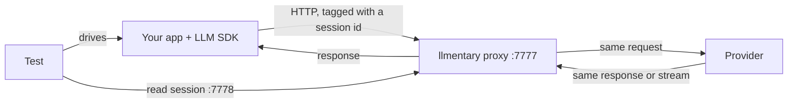

# How llmentary works

llmentary has two parts: a proxy that records LLM API calls, and a client
library for your test framework that reads the recording and runs assertions.

## The proxy

The proxy is a single Go binary. It listens on two addresses:

- the **proxy listener** (default `:7777`; the clients use `127.0.0.1:7777`),
  where your SDK sends requests instead of to the provider;
- the **control API** (default `127.0.0.1:7778`), where test clients read
  recorded sessions.

The proxy forwards each request to the configured upstream (by default
`https://api.openai.com/v1`) without changing the body or the `Authorization`
header, and streams the response back as it arrives. Your SDK authenticates
with the provider as usual; the proxy never holds or adds an API key.

While forwarding, it keeps a copy of both sides and, for OpenAI-format calls,
parses them: messages, tools offered, tool calls and their arguments, finish
reason, token usage, latency, time to first token, HTTP status and errors.
Recordings are kept in memory until the proxy exits or the session is deleted.

Several upstreams can be configured by name and addressed as `/u/{name}/...`.
See [Providers](providers.md) and [Proxy reference](proxy.md).

## Sessions

Every recorded call belongs to one session. A session usually corresponds to
one test. The client creates a unique session id per test and the proxy decides
which session a request belongs to by checking, in order:

1. the `X-Test-Session` request header,
2. W3C `baggage` (`llmentary.session.id=<id>`),
3. a path prefix: `http://127.0.0.1:7777/s/<id>/v1`,
4. a fallback session for untagged calls (`--default-session`, default
   `default`).

The header is the simplest option when the test creates the SDK client. The
path prefix works when the app builds its own client from a base-URL setting
and cannot add headers. [Connect an existing app](how-to/connect-an-app.md)
covers both.

## Waiting for calls

Apps often make LLM calls asynchronously: a background worker, a streaming
response, a tool loop with several round trips. An assertion that reads the
session too early sees too few calls.

So `expect()` first waits. It returns once the session has had no new
calls for a quiet period (default 500 ms) and no call is still in flight, or
fails after a timeout (default 30 s). Both can be set per call or with
`LLMENTARY_WAIT_QUIET` and `LLMENTARY_WAIT_TIMEOUT`. When a call may start
late, wait for a minimum number of calls (`MinCalls` / `min_calls`). Details:
[Session lifecycle](session-lifecycle.md).

## What you assert on

A recorded call is the exchange as it happened on the wire. Most of it is
deterministic given your app's code and fixtures:

| Deterministic | Varies between runs |
|---|---|
| Tools offered in the request | The text of the answer |
| Request parameters, model, system prompt | Which tool the model picks, when more than one fits |
| Tool results your app sent back | Argument values the model invents |
| Number of calls and retries, HTTP status | Token counts, latency |

The left column is what llmentary is built for. The right column can still be
asserted, with care: bounds instead of exact values for tokens and latency,
and tolerant matching for text. See
[Assert on model output](how-to/model-output.md).

## Call outcomes

Each finished call has an `outcome`:

- `committed`: the response arrived completely.
- `cancelled`: your client aborted the request, for example when a user
  interrupts a streaming answer.
- `failed`: the provider returned an error status, the stream broke, or the
  request never got a response.

`NoErrors` fails on `failed` calls only. `CallCount` does not count `cancelled`
calls unless you ask it to. To assert on cancellation itself, use `Aborted` or
`NoCancelled`. The full rules are in [Data model](data-model.md#terminal-states-and-the-abort-record).

## Spec validation

The proxy validates every request against the OpenAI API schema and records
findings on the call: unknown fields, wrong types, invalid enum values. By
default it only records and logs them (`--spec-validation=warn`). With
`enforce` it rejects invalid requests locally without calling the provider.
`NoSpecViolations` and `NoIgnoredFields` assert on these findings. For
OpenAI-compatible providers, which accept extra fields, see
[OpenAI-compatible providers](openai-compatible.md).
