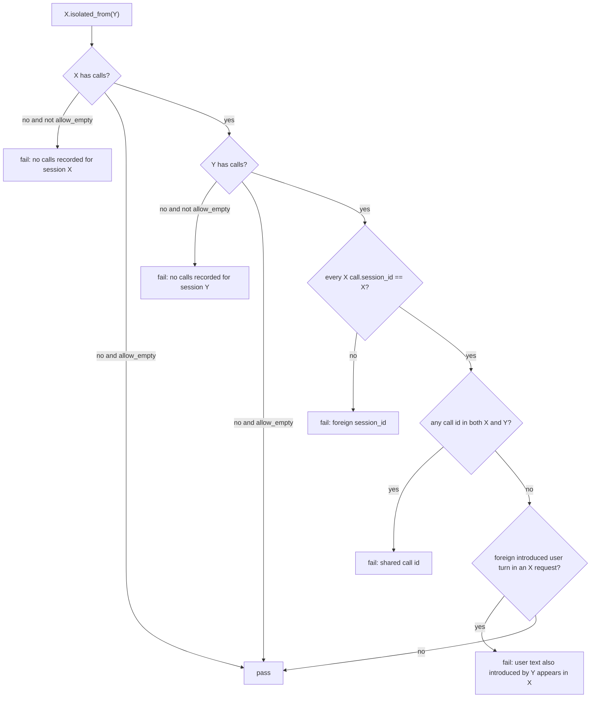

# Isolation spec (`isolated_from`)

This is the single cross-language definition of
`IsolatedFrom` / `isolated_from` / `isolatedFrom`. Client READMEs link here
instead of restating the rules. Normative fixtures live in
[`testdata/isolation/`](../testdata/isolation/README.md). Every client vendors
those JSON files and must produce the same verdicts.

Related: [Black-box: proving isolation](black-box.md#proving-isolation),
[DOG-20](black-box.md#what-a-path-prefix-isolates), [DOG-22](isolation-spec.md#rule-3-no-foreign-user-turn).

## Verdict

Session **X** is isolated from session **Y** when all four rules hold. The
helper is directional: check both `X.isolated_from(Y)` and
`Y.isolated_from(X)` when the test is "two parallel runs".



## Options

| Option | Default | Meaning |
|---|---|---|
| `allow_empty` | `false` | Empty **X** or empty **Y** is a failure unless this is set (DOG-21, DOG-32). |
| `min_chars` | `8` | Normalized texts shorter than this are ignored for rule 3. |
| `ignore_texts` | `[]` | Extra texts ignored for rule 3 after normalization. |

System / developer prompts and tool definitions are never compared.

## Rule 1 — session id

Every call in X has `session_id == X`'s id.

Failure fragment: `session_id`.

## Rule 2 — call ids are disjoint

No `call.id` appears in both sessions.

Failure fragment: `call id`.

## Rule 3 — no foreign user turn

Comparison is an **exact match after normalization**, never a substring.

Normalization: trim, collapse any whitespace to a single space, Unicode
casefold. Multi-part `content` / `input` items are joined in order (the `text`
or `input_text` / `output_text` field of each part).

User-role messages only:

- Chat Completions: `messages[role=user]`
- Responses: `input` as a string (one user turn) or `input[role=user]` items

**Introduced** texts of a session: walk its calls in `seq` order. A text is
introduced when it **first appears** as a user-role message in that walk —
every first appearance, not only the last user message of a call.

- The **first** call treats only its **last** user-role message as introduced
  (the new turn). Earlier user messages on that first request are inbound
  history, not introductions (`seen`, not `introduced`).
- Later calls introduce **each** user-role message whose normalized form was
  not already present in an earlier call of the same session. A later request
  that adds two new user messages introduces both. Implementations that take
  only the last user message of each call fail
  `later-call-two-new-user-messages.json`.

A leak is a user-role message **appearing in any request of X** (history
included) whose normalized form is in `introduced(Y)` and not in
`introduced(X)`, after `min_chars` / `ignore_texts`.

Texts both sessions introduced themselves are **not** a leak. That is why two
independent runs of the same canned question pass.

Failure shape (required fragments):

```text
user text '<text>' also introduced by session <Y> #<seq> (<call_id>) appears in session <X> #<seq> (<call_id>)
```

`<text>` is the leaked user string as stored (trimmed, original case). Both
`#seq (call_id)` pairs are present: Y is a session that introduced the
text, X is the session whose request contains it. The wording is
`also introduced by` because rule 3 is text-only (see
[Attribution](#attribution)).

## Rule 4 — empty X

If X has no calls and `allow_empty` is false, fail with
`no calls recorded for session <X>`. If `allow_empty` is true, pass.

## Rule 4b — empty Y

If X has calls and Y has none (never created, mistyped id, or an unused
session), fail unless `allow_empty` is set:

```text
no calls recorded for session <Y> (isolated_from needs calls on both sides)
```

`<Y>` is the id the caller passed, including a typo. An empty other is the
usual wiring mistake (wrong base URL, the second app never booted). It is
not a vacuous pass. `allow_empty` covers both sides; there is no separate
`allow_empty_other`.

## What is not a leak

- Identical system / developer prompts
- Shared tool names or schemas
- The same canned user question sent independently by both sessions
- A short text such as `Hi` that is only a substring of the other session's
  user turn (`min_chars` also drops texts shorter than 8 by default)

## Parallel same-scenario example

```python
lm_a = llmentary()  # or Go llmentary.New(t) / JS llmentary()
lm_b = llmentary()
# both apps send "What is my biological age?"
lm_a.expect().isolated_from(lm_b)  # pass
lm_b.expect().isolated_from(lm_a)  # pass
```

A third session that **replays** A's first user message as history (Mongo /
checkpointer / conversation state) fails rule 3 with the spec message above.

## Attribution

Rule 3 matches **text**, not a causal source. If A and B independently send
the same canned question and C replays A's turn, both
`C.isolated_from(A)` and `C.isolated_from(B)` fail. The message names B
even though B never touched A's thread.

That is inherent to exact text match. The helper reports every other
session that introduced the leaked text; it cannot tell which one leaked.

**Recipe when you need to know which session leaked:** make each run's
**first** user message unique (a run id, nonce, or per-session user name
in the text). Keep the shared canned question only for the parallel
same-scenario check (`A ⊥ B`). Then `C.isolated_from(A)` still fails and
`C.isolated_from(B)` passes.
