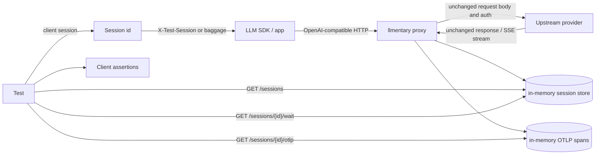

# Proxy reference

`llmentary` starts two HTTP servers:

- the proxy listener, which forwards SDK/provider traffic and records calls;
- the control listener, which exposes recorded sessions and in-memory OTLP spans.

The proxy does not translate request or response formats. It forwards the upstream
request body, response body, and streaming bytes unchanged, while recording a tee copy for
tests.

## How it works



The proxy forwards the provider protocol unchanged. It records a tee copy, parses
OpenAI-wire calls when it can, and leaves everything else as raw passthrough.

## CLI flags, environment, and config

There is no config file format in the current code. Configuration comes from environment
variables plus CLI flags.

| CLI flag | Environment | Default | Meaning |
|---|---|---|---|
| `--listen` | `LLMENTARY_LISTEN` | `:7777` | Proxy listen address. |
| `--version` / `-version` | none | n/a | Print `llmentary <semver> (<commit>, <date>, <go version>, <os>/<arch>)` and exit 0. Release binaries use the clean tag version. |
| `--control` | `LLMENTARY_CONTROL_LISTEN` | `127.0.0.1:7778` | Control API listen address. |
| `--control-token` | `LLMENTARY_CONTROL_TOKEN` | empty | Bearer token required by the control API when set. Also required when the control listener is non-loopback. |
| `--upstream` | `LLMENTARY_UPSTREAMS`, fallback `LLMENTARY_UPSTREAM` | `openai=https://api.openai.com/v1` | Upstream mapping. Repeat the flag or use comma-separated environment values. When omitted, the proxy logs `no upstream configured; defaulting to openai=https://api.openai.com/v1`. |
| `--tls` | none | `false` | Parsed by the CLI, but not wired to a TLS listener in the current code. |
| `--spec-validation` | `LLMENTARY_SPEC_VALIDATION` | `warn` | Request spec validation mode: `off`, `warn`, or `enforce`. Invalid values exit non-zero. |
| `--spec-profile` | `LLMENTARY_SPEC_PROFILE` | `relaxed` | Spec profile: `strict` (pinned spec + closed-world) or `relaxed` (strict plus `api/openai/relax-overlay.yaml`). |
| `--spec-validation-max-bytes` | `LLMENTARY_SPEC_VALIDATION_MAX_BYTES` | `8388608` | Maximum request body size to validate. Larger bodies are forwarded and marked `skipped_reason: body_too_large`. |
| `--spec-log-max` | `LLMENTARY_SPEC_LOG_MAX` | `5` | After the summary WARN, log at most this many per-finding WARN lines. `0` logs the summary only. |
| `--session-from` | `LLMENTARY_SESSION_FROM` | `header,baggage,path,default` | Ordered session sources. Invalid values exit non-zero. |
| `--default-session` | `LLMENTARY_DEFAULT_SESSION` | `default` | Session id used when `default` is in `--session-from` and the call has no other marker. |
| `--allow-path-prefix` | `LLMENTARY_ALLOW_PATH_PREFIXES` | empty | Extra first path segments allowed after `/s/{session}` and `/u/{name}` are stripped. Repeatable, or comma-separated in the env var. |
| `--propagate-trace` | `LLMENTARY_PROPAGATE_TRACE` | `off` | `off` forwards the client's `traceparent` / `tracestate` unchanged (and adds none). `auto` injects or continues a W3C `traceparent` for the proxy CLIENT span. |

With no `--upstream` and no `LLMENTARY_UPSTREAMS` / `LLMENTARY_UPSTREAM`, the proxy
defaults to `openai=https://api.openai.com/v1`. `GET /config` reports the effective
upstreams (names and sanitized URLs). An upstream whose host:port is the proxy listen
address (including `localhost`, `127.0.0.1`, `0.0.0.0`, and `[::1]` on the same port)
is refused at startup so the proxy cannot loop on itself.

```bash
llmentary \
  --listen 127.0.0.1:7777 \
  --control 127.0.0.1:7778
```

Equivalent explicit configuration, plus a second named Azure upstream:

```bash
llmentary \
  --listen 127.0.0.1:7777 \
  --control 127.0.0.1:7778 \
  --upstream openai=https://api.openai.com/v1 \
  --upstream azure=https://my-resource.openai.azure.com
```

Equivalent environment configuration:

```bash
export LLMENTARY_LISTEN=127.0.0.1:7777
export LLMENTARY_CONTROL_LISTEN=127.0.0.1:7778
export LLMENTARY_UPSTREAMS='openai=https://api.openai.com/v1,azure=https://my-resource.openai.azure.com'
llmentary
```

`--upstream` accepts either `name=https://host/base` or a bare URL. A bare URL is stored
under the name `default`. If the same name is configured more than once, the later value
wins.

## Named upstreams and path prefixes

Named upstreams are addressed with `/u/{name}/...` on the proxy listener. The rest of the
path is joined to the configured upstream base path.

```text
http://127.0.0.1:7777/u/openai/chat/completions
  -> https://api.openai.com/v1/chat/completions

http://127.0.0.1:7777/u/azure/openai/deployments/my-deployment/chat/completions?api-version=2024-10-21
  -> https://my-resource.openai.azure.com/openai/deployments/my-deployment/chat/completions?api-version=2024-10-21
```

Bare proxy paths are accepted only when exactly one upstream exists or when an upstream
named `default` exists:

```text
http://127.0.0.1:7777/v1/chat/completions
  -> https://api.openai.com/v1/chat/completions
```

That combination used to repeat the version segment. The join rule below overlaps
shared path prefixes, so both `https://api.openai.com` and `https://api.openai.com/v1`
work with both `{proxy}/v1` and `{proxy}/u/openai`.

With multiple upstreams and no `default`, a bare path returns `502 Bad Gateway` with
`bare proxy path requires exactly one upstream or a default upstream`.

## Path join

Joining the configured upstream base to the request path is proxy routing, not a rewrite
of the client's request body or headers. When the upstream base path ends with segments
that the request path starts with, those segments are used once:

| Upstream form | Client base URL | Final URL |
|---|---|---|
| `https://api.openai.com/v1` | `{proxy}/v1` | `https://api.openai.com/v1/chat/completions` |
| `https://api.openai.com/v1` | `{proxy}/u/openai` | `https://api.openai.com/v1/chat/completions` |
| `https://api.openai.com` | `{proxy}/v1` | `https://api.openai.com/v1/chat/completions` |
| `https://api.openai.com` | `{proxy}/u/openai/v1` | `https://api.openai.com/v1/chat/completions` |
| `https://openrouter.ai/api/v1` | `{proxy}/v1` | `https://openrouter.ai/api/v1/chat/completions` |
| `https://openrouter.ai/api/v1` | `{proxy}/u/openrouter` | `https://openrouter.ai/api/v1/chat/completions` |
| `https://my-resource.openai.azure.com/openai/v1` | `{proxy}/u/azure` | `https://my-resource.openai.azure.com/openai/v1/chat/completions` |
| `https://my-resource.openai.azure.com` | `{proxy}/u/azure/openai/deployments/my-dep/chat/completions` | `https://my-resource.openai.azure.com/openai/deployments/my-dep/chat/completions` |

A `/s/{session}` prefix (session attribution) is stripped before this join; remaining
`/u/{name}` is stripped the same way.

## API type detection

The parser chooses an API family from the upstream method and final upstream path:

| Condition | `api_family` |
|---|---|
| `POST` and path ends with `/chat/completions` | `openai.chat` |
| `POST` and path ends with `/responses` | `openai.responses` |
| Anything else | `passthrough` |

Passthrough calls are still recorded, including headers, raw request/response bytes,
status, timings, and spans. They are not parsed into tool calls, usage, or provider
finish reasons.

Azure `api-version` is extracted from the upstream query string. Azure deployment is
extracted from `/deployments/{deployment}/...` path segments.

## Session attribution

Each call is stored in one session. `--session-from` is an ordered list of sources
(default `header,baggage,path,default`):

1. `header`: `X-Test-Session: <id>`.
2. `baggage`: W3C `baggage` keys `llmentary.session.id`, `llmentary.session`,
   `test-session`, or `x-test-session`.
3. `path`: `/s/{session}/...` on the proxy listener. `{session}` is one path
   segment, percent-decoded, max 256 bytes, no `/` or control characters.
   The prefix is stripped before routing and forwarding. It composes with named
   upstreams: `/s/{session}/u/{name}/...`. Recorded calls get `session_source:"path"`.
4. `default`: `--default-session` (default `default`). This is the sidecar recipe:
   `--default-session=livekit-e2e` records every untagged call on that session.

When `default` is not in `--session-from` and a call has no usable marker, the
proxy answers locally with `400` and an OpenAI-shaped JSON error
(`type`/`code` `llmentary_session_required`). It is never forwarded.

`--session-from=path` is how an unmodified service attributes calls: set its
base URL to `{proxy}/s/{id}/v1` (or `{proxy}/s/{id}/u/{name}`). Compose,
import-time clients, and `--default-session` sidecar recipes are in
[Black-box and sidecar setups](black-box.md).

### No leaks of unknown prefixes

After `/s/{session}` and `/u/{name}` are stripped, the first remaining segment
must be one of: `v1`, `openai`, `api`, `chat`, `responses`, `completions`,
`embeddings`, `models`, `files`, `audio`, `images`, `moderations`, `batches`,
`uploads`, `vector_stores`, `assistants`, `threads`, `realtime`.
`--allow-path-prefix` extends that list.

Anything else gets a local `404` JSON error (`type`/`code` `llmentary_unknown_path`)
and is **not** forwarded. The message includes `did you mean /s/<segment>/...?`
when the request had a single extra leading segment (`/dogfood/v1/...` suggests
`/s/dogfood/v1/...`). One WARN line is written (`method`, `path`; no header values).

The Go client in [llmentary-go](https://github.com/barzoj-co/llmentary-go)
creates a random session id and can inject `X-Test-Session` through `lm.HTTPClient()`.
Unmodified services that cannot send headers should use the path prefix
(`lm.PathBaseURL()` / `lm.path_base_url()` / `lm.pathBaseURL()`) instead.

## What the proxy changes on the way upstream

Default is **pure pass-through**. Method, query string, body bytes, and all
request headers (including `Authorization` and unknown `x-*`) are forwarded
byte-identical, except llmentary's own markers and HTTP hop-by-hop headers.

| Change | When | Why |
|---|---|---|
| Strip `X-Test-Session` | always | Our session header; not an upstream header. |
| Strip `llmentary.*` baggage members | always | Our markers. Other baggage is preserved. |
| Strip `/s/{session}` and `/u/{name}` prefixes | always | Routing wrappers; the upstream must see the wire path. |
| Remove hop-by-hop headers (`Connection`, `Proxy-Connection`, `Keep-Alive`, `Proxy-Authenticate`, `Proxy-Authorization`, `Te`, `Trailer`, `Transfer-Encoding`, `Upgrade`, and any header named by `Connection`) | always | RFC 7230: hop-by-hop headers are not forwarded. |
| Set `Host` to the upstream host | always | Required to send the request to that host. |
| Inject `traceparent` / `tracestate` | only `--propagate-trace=auto` | Continue or start a W3C trace for the proxy CLIENT span. Default `off` forwards the client's `traceparent` unchanged and adds none. |
| `Accept-Encoding: identity` | **never** (removed) | The proxy no longer forces identity encoding. |

The proxy does **not** set `Accept-Encoding: identity`. If the client sends
`Accept-Encoding: gzip` (or any other value), that header is forwarded unchanged.

If the upstream returns a compressed body (`gzip`, `deflate`, `br`, `zstd`),
the proxy decompresses a **copy** for recording and parsing, and returns the
original bytes and headers to the client unchanged. Unknown encodings are
recorded as raw bytes with a WARN.

Auth headers are forwarded to the provider. They are only redacted in the recorded copy.

## SSE passthrough semantics

Streaming responses are passed through byte-for-byte to the SDK client. The proxy flushes
after each copied chunk when the response writer supports flushing.

For recording:

- `Content-Type: text/event-stream` is parsed as SSE.
- If the SSE response is not gzip-encoded, events are recorded incrementally as chunks
  arrive.
- If the upstream still returns gzip, the client receives the gzip bytes unchanged, while
  the recorded tee copy is decompressed for parsing. Gzip is stored decompressed
  because `raw_response` is the parse input (and the E6 hash subject), not a
  wire-capture of the HTTP envelope. See `docs/data-model.md` § Gzip and
  raw-byte hashes.
- A Chat Completions stream is considered complete when a `data: [DONE]` event is seen.
  If every seen choice has a `finish_reason` and a usage object arrived, but `[DONE]`
  is missing, the stream is treated as complete with parser warning `no_done_marker`
  instead of `stream_truncated`. A finish without usage (or usage without finish) and
  no `[DONE]` stays truncated.
- A Responses stream is considered complete when a terminal `response.completed`,
  `response.failed`, or `response.incomplete` event is parsed. Responses is unchanged
  by the Chat Completions `[DONE]` hardening.
- SSE comment lines, including OpenRouter keep-alive comments, are recorded as comments
  and ignored by the normalizer.
- If no terminal marker/event is seen, `normalized.stream_truncated` is set.

## Secret redaction

Recorded headers redact these names by replacing values with `sha256:<16 hex chars>`:

- `Authorization`
- `api-key`
- `x-api-key`
- `x-goog-api-key`
- `Cookie`
- `Set-Cookie`

Recorded upstream URLs redact these query parameters the same way:

- `key`
- `api_key`
- `sig`
- `signature`

Raw request and response bodies are stored for test assertions and are not redacted by the
current implementation. Treat the local control API as sensitive.

## Control API bind and token security

The default control address is loopback-only: `127.0.0.1:7778`.

If `--control-token` or `LLMENTARY_CONTROL_TOKEN` is set, every control API request must
send:

```http
Authorization: Bearer <token>
```

If the control address is non-loopback, validation fails unless a control token is set.
`localhost` and loopback IP addresses are accepted as loopback. A hostless bind such as
`:7778` is treated as non-loopback and therefore requires a token.

## Control endpoints

All endpoints are on the control listener, not the proxy listener. The machine-readable
contract is `GET /openapi.yaml`, based on `api/control/openapi.yaml` with
`info.version` stamped at serve time.
Unknown query parameters and unparsable values
return `400` `{"error":{"type":"invalid_parameter","param":"…","message":"…"}}`.
`timeout` and `quiet` accept Go durations (`30s`, `500ms`) and plain seconds (`90`,
`0.2`). Values `<= 0` or above 10 minutes are `400`. Every error response
(`400`/`401`/`404`/`405`/`504`) is `application/json` with `error.type`.

### `GET /openapi.yaml`

Returns the control API OpenAPI document (`application/yaml`). `info.version`
is stamped at serve time from the same release version as `--version` and
`GET /version` (dev builds serve `devel`). Requires the control token when
`--control-token` is set.

The packaged file (`api/control/openapi.yaml`, also shipped in release
tarballs / npm / PyPI) is the source. Served bytes are
`StampOpenAPIVersion(packaged, version)`: the first `version:` line under
`info:` is rewritten and the `# x-release-please-version` marker on that
line is dropped (27 bytes when the version string is unchanged). That is
the only documented, normalized difference. Compare sha256 of served bytes
to sha256 of the stamped packaged file, not the raw vendored file.

```bash
curl http://127.0.0.1:7778/openapi.yaml
```

### Session lifecycle

| State | `GET /sessions/{id}` | `wait` `min_calls=0` | `wait` `min_calls>=1` | `DELETE` | `GET /sessions` |
|---|---|---|---|---|---|
| Never created | `404` | `504` `wait_timeout` after `quiet` | `504` `wait_timeout` after timeout | `204` | absent |
| In-flight only | `200` empty `calls` | wait while `active>0` | wait while `active>0` | `204` | present, `active>0` |
| Has settled calls | `200` | `200` after quiet | `200` when quiet and enough settled calls | `204` | present |
| Deleted | `404` | `504` `wait_timeout` after `quiet` | `504` `wait_timeout` after timeout | `204` | absent |

The wait statuses are implemented by `serveWait` / `WaitQuiet`. See
`GET /sessions/{id}/wait` below for the request shape.

### `GET /healthz`

Returns `200 OK` and a plain text body.

```bash
curl -i http://127.0.0.1:7778/healthz
```

```http
HTTP/1.1 200 OK

ok
```

### `GET /sessions` and `GET /sessions/`

Both return `200 application/json` with no redirect. Cheap: no call bodies.

```json
{"sessions":[{"id":"default","calls":3,"active":0,"sources":["default"],"first_started_at":"…","last_ended_at":"…","spec":{"checked":3,"clean":3,"findings":0,"request_only":0,"not_checked":0,"Checked":3,"Clean":3,"Findings":0,"RequestOnly":0,"NotChecked":0}}]}
```

`spec` counters use snake_case keys that match the `proxy response` `spec=`
tokens. PascalCase aliases (`Checked`, `Clean`, …) are still serialized for
0.x clients and are marked `deprecated: true` in OpenAPI (removed in 1.0).
Invariant: `calls == checked + request_only + not_checked` and
`checked == clean + findings`. `request_only` is a request that was validated
when the response was not (abort before headers, HTTP 4xx). `spec=off` and
`spec=skipped:*` increment `not_checked`.

Barge session after one clean greeting and one before-headers abort:

```text
INFO proxy response status=200 call_id=call_1 session=barge seq=1 api_family=openai.responses spec=clean
INFO proxy response status=- call_id=call_2 session=barge seq=2 api_family=openai.responses spec=request_only client_aborted=true phase=before_headers
```

```json
{"id":"barge","calls":2,"spec":{"checked":1,"clean":1,"findings":0,"request_only":1,"not_checked":0}}
```

Sorted by `first_started_at`. Optional `?source=default|header|baggage|path` filters
the list. Zero sessions: `{"sessions":[]}`.

### `GET /sessions/{id}`

Returns the current session immediately. `calls` contains only **settled**
records (`ended_at` set). An in-flight call is counted in `GET /sessions`
`active` and keeps `wait` open, but it is omitted from this array until
`Finish` publishes the final record atomically — including abort fields
(`client_aborted`, `abort_phase`, `finish_reason`). A session with only
in-flight work is `200` with `calls: []`, not a placeholder
(`http_status=0`, `client_aborted=false`).

Unknown ids (never recorded, or deleted)
return `404` `{"error":{"type":"session_not_found","message":"no calls recorded for session \"{id}\"; list sessions with GET /sessions"}}`. GETs never create sessions.

```bash
curl http://127.0.0.1:7778/sessions/test-1
```

```json
{
  "id": "test-1",
  "calls": [
    {
      "id": "call_1",
      "session_id": "test-1",
      "session_source": "header",
      "seq": 1,
      "started_at": "2026-10-18T08:54:00Z",
      "ended_at": "2026-10-18T08:54:01Z",
      "latency_ms": 742,
      "provider": "openai",
      "api_family": "openai.chat",
      "upstream": {
        "method": "POST",
        "url": "https://api.openai.com/v1/chat/completions"
      },
      "request": {
        "headers": {
          "Authorization": ["sha256:0123456789abcdef"]
        }
      },
      "response": {
        "headers": {
          "Content-Type": ["application/json"]
        }
      },
      "stream": false,
      "http_status": 200,
      "normalized": {
        "derived_version": 3,
        "model": {
          "requested": "gpt-4.1-mini",
          "returned": "gpt-4.1-mini"
        },
        "finish_reason": "stop"
      }
    }
  ]
}
```

`raw_request`, `raw_response`, and `sse_events[].data` are Go `[]byte` fields and appear
as base64 strings in JSON.

### `GET /sessions/{id}/wait`

Waits until the session has at least `min_calls` **settled** calls, no active calls,
and has been quiet for `quiet` after the last session activity (a call start or
finish). In-flight placeholders are not counted and are not included in the
returned `calls` array. That can be immediate when the session is already idle. A session that
does not exist yet is waited for until it appears **only when `min_calls>=1`**.
`min_calls=0` on a never-created (or `DELETE`d) session is not success: it
returns `404` `session_not_found` immediately, with the same error as
`GET /sessions/{id}` plus `id` and `waited_ms`. `min_calls>=1` on a missing
session keeps waiting until a call arrives or `timeout`, then `504`
`wait_timeout` with `calls_seen:0`. Use `min_calls` when a call is about to
start and must be observed; `quiet` is not a grace period for that.

See [Session lifecycle](session-lifecycle.md) for the status table and an example.

| State | `GET /sessions/{id}` | `wait` `min_calls=0` | `wait` `min_calls>=1` | `DELETE` | `GET /sessions` |
|---|---|---|---|---|---|
| Never created | `404` | `404` `session_not_found` immediately | `504` `wait_timeout` after timeout | `204` | absent |
| In-flight only | `200` empty `calls` | wait while `active>0` | wait while `active>0` | `204` | present, `active>0` |
| Has settled calls | `200` | `200` after quiet | `200` when quiet and enough settled calls | `204` | present |
| Deleted | `404` | `404` `session_not_found` immediately | `504` `wait_timeout` after timeout | `204` | absent |

Query parameters:

| Name | Default | Meaning |
|---|---|---|
| `quiet` | `500ms` | Required quiet period after the last call start or finish. Already-elapsed idle time counts. |
| `timeout` | `30s` | Maximum wait before `504`. |
| `min_calls` | `0` | Minimum finished calls. Wait for a call that has not started yet with this, not with `quiet`. |

```bash
curl 'http://127.0.0.1:7778/sessions/test-1/wait?quiet=100ms&timeout=5s&min_calls=2'
```

`200` is the same session JSON as `GET /sessions/{id}`. `404` names the session
and includes `waited_ms`. `504` includes the partial session plus
`{"error":{"type":"wait_timeout","calls_seen":k,"min_calls":N}}`.

### `GET /sessions/{id}/otlp`

Returns OTLP/JSON trace data for spans recorded in the session. Unknown sessions are
`404` `session_not_found`.

```bash
curl http://127.0.0.1:7778/sessions/test-1/otlp
```

```json
{
  "resourceSpans": [
    {
      "resource": {
        "attributes": [
          {
            "key": "service.name",
            "value": { "stringValue": "llmentary-proxy" }
          }
        ]
      },
      "scopeSpans": [
        {
          "scope": {
            "name": "github.com/barzoj-co/llmentary/proxy",
            "version": "0.1.0-dev"
          },
          "spans": []
        }
      ]
    }
  ]
}
```

See [OTel GenAI mapping](otel.md) for span attributes.

### `DELETE /sessions/{id}`

Deletes the session calls and OTLP spans. Unknown ids still return `204` (reset is
idempotent). After delete, `GET` is `404` again.

```bash
curl -i -X DELETE http://127.0.0.1:7778/sessions/test-1
```

```http
HTTP/1.1 204 No Content
```

### Unsupported methods

Unsupported methods return `405` `{"error":{"type":"method_not_allowed"}}` with `Allow`.

### `GET /config`

Returns the effective spec-validation settings so clients can tell "validated, clean" from "not validated", plus the clean binary version:

```json
{"spec_validation":"warn","spec_profile":"relaxed","spec_sha":"…","schema_subset_retrieved":"2026-10-18","upstreams":{"openai":"https://api.openai.com/v1"},"version":"0.3.0"}
```

### `GET /version`

Returns the clean version and commit (no `v` prefix):

```json
{"version":"0.3.0","commit":"…","date":"…"}
```

### Versions

The **release version** is the single source of truth. `--version`,
`GET /version`, `GET /config` `version`, and served `GET /openapi.yaml`
`info.version` always match. Clients print that string in the test header
(DOG-13). `go build` / `go install` without ldflags use `devel`.

## Spec validation

Raw Chat Completions and Responses request bytes are validated against the pinned OpenAI sub-spec after capture and before the typed handler. The original bytes are always forwarded (or, in `enforce`, not forwarded). Response bytes are validated report-only after they have been flushed to the client.

Where findings show up: trace (`normalized.spec_violations`), proxy log (WARN), client assertions.

| Field | What it is | Empty vs absent |
|---|---|---|
| `validation` | Metadata: was the call checked, and how (`mode`, `profile`, `spec_sha`, checked flags, `skipped_reason`). Not a list of problems. | Absent when validation was not run (`off`). Present in `warn`/`enforce` even when the call is clean. |
| `spec_violations` | Findings from the spec validator. | `[]` means checked and clean. Absent means not checked. |
| `ignored_fields` | Silently ignored request content (unknown schema keywords, unknown request fields, strict fallback). | Same empty-vs-absent rule as `spec_violations`. |

How to tell a clean run from an unchecked one: the `INFO proxy response` line
always carries a compact `spec=` field. `spec=clean` means request and response
were checked and produced zero findings. `spec=findings:N` is the finding count.
`spec=off` is validation disabled. `spec=skipped:<reason>` is a skip
(`body_too_large`, `unsupported_content_encoding`, …). `spec=request_only` means
the request was checked and the response was not (for example a cancel before
headers). In the trace, `spec_violations: []` is clean and an absent
`spec_violations` key is not checked. Startup logs the effective config once:
`INFO spec validation mode=warn profile=relaxed spec_sha=… max_bytes=8388608`.
`GET /sessions` list items also include
`spec: {"checked","clean","findings","request_only","not_checked"}` counters
(plus deprecated PascalCase aliases). `request_only` is request checked /
response not (not counted as `clean` or `checked`).
`calls == checked + request_only + not_checked` and
`checked == clean + findings`.

In `warn` and `enforce`, after the call finishes the proxy writes one WARN summary per finding category (`msg="spec violations"` and/or `msg="ignored fields"`), then one WARN line per finding (before identical rows are collapsed). `--spec-log-max` (default 5; `0` is summaries only) is a single per-call budget shared across both categories. Detail lines include `call_id`, pointers, keywords, kinds, and schema messages. Streamed response findings also include `event=<index>` so chunks can be told apart. `unevaluatedProperties` / `additionalProperties` messages name the field (`unknown field "temprature" (not in the OpenAI spec for chat.completions request)`); `keyword` and `pointer` are unchanged. Format-keyword messages are replaced with `format validation failed`. Value-bearing keywords (`pattern`, `minimum`, `maximum`, `exclusiveMinimum`, `exclusiveMaximum`, `multipleOf`, `enum`, `minLength`, `maxLength`, `minItems`, `maxItems`) use `schema validation failed`, so rejected field values are not logged. Summaries include `session` (the recorded session id, as in `proxy request` / `proxy response`). They never include request bodies, field values, or `Authorization` / cookie / api-key header values. Enforce rejections use the same WARN lines.

Example:

```text
level=WARN msg="spec violation" call_id=call_1 side=request pointer=/temprature keyword=unevaluatedProperties message="unknown field \"temprature\" (not in the OpenAI spec for chat.completions request)"
level=WARN msg="spec violation" call_id=call_2 side=response pointer=/ keyword=required message="missing property 'created'" event=3
```

Identical findings (same side, keyword, pointer, message) on one call are stored once with `count=N` and the first `event_index`. WARN lines are the per-occurrence lines above.

| Mode | Behavior |
|---|---|
| `off` | No compile, no run. `validation`, `spec_violations`, and `ignored_fields` are absent from the trace. |
| `warn` (default) | Record findings and forward byte-for-byte. Arrays are always present (`[]` when clean). |
| `enforce` | If there is a request-side `spec_violation` or a `reject_in_enforce` ignored field, the proxy answers a local 400 and does **not** call the upstream. Response-side findings never reject. |

Local enforce 400:

```http
HTTP/1.1 400 Bad Request
Content-Type: application/json
X-Llmentary-Rejected: spec_violation

{"error":{"message":"llmentary: request rejected (profile=relaxed): …","type":"invalid_request_error","param":"…","code":"llmentary_spec_violation"}}
```

`code` is `llmentary_spec_violation` or `llmentary_ignored_field`. Streamed requests still get a JSON 400, not SSE.

Profiles:

- `strict`: pinned spec plus the closed-world transform (`unevaluatedProperties:false` on complete object schemas; allOf fragments stay open so compositions still work; free-form payloads such as tool `parameters` stay open).
- `relaxed`: `strict` plus `api/openai/relax-overlay.yaml`. Overlay entries are live-verified.

**D5 (reworded).** In `--spec-validation=off` and `warn` modes, a request body that does not decode into the generated type (malformed JSON, valid JSON with a field of unknown type, trailing data) is **not** answered by the proxy: it goes upstream byte-for-byte, the client gets the upstream response, and `parser_warnings` contains the reason; in `warn`, `spec_violations` also records it. In `enforce` mode, and only for requests, the proxy answers a local OpenAI-shaped 400 (`code: llmentary_spec_violation` or `llmentary_ignored_field`) **without calling the upstream** if there is at least one request-side spec violation or reject-class ignored field. Responses are never rejected or altered in any mode.

## Logs

Every finished call writes one `INFO proxy response` line, including client
aborts and upstream connection errors.

```text
INFO proxy response status=200 call_id=call_1 session=weather seq=1 api_family=openai.responses spec=clean
INFO proxy response status=- call_id=call_2 session=barge seq=2 api_family=openai.responses spec=request_only client_aborted=true phase=before_headers
INFO proxy response status=200 call_id=call_3 session=barge seq=3 api_family=openai.responses spec=clean client_aborted=true phase=after_headers
INFO proxy response status=502 call_id=call_4 session=weather seq=4 api_family=openai.responses spec=off
```

Field order is `status call_id session seq api_family spec`, then abort
fields when they apply. `status=-` and `phase=before_headers` mean the
inbound request context was cancelled before the upstream sent headers.
`phase=after_headers` is a cancel after `200` headers (mid-stream); the
trace keeps `http_status: 200`, partial SSE, `finish_reason: cancelled`.
Neither abort is a proxy `502`. A live client plus a refused / DNS / TLS
failure stays `status=502` with `error.normalized: "network"`. A close
after the terminal SSE event (`[DONE]` / `response.completed`) is **not**
`client_aborted`.

## Features

- Reverse proxy binary: `cmd/llmentary`.
- Named upstreams, including `/u/{name}/...` routing and bare-path routing for a single
  upstream or a `default` upstream.
- OpenAI Chat Completions parser for streaming and non-streaming responses.
- OpenAI Responses parser for streaming and non-streaming responses.
- Azure OpenAI paths with dated `api-version` query strings, deployment extraction, and
  `/openai/v1`-style OpenAI-compatible URLs.
- OpenRouter/OpenAI-compatible stream tolerance, including keep-alive comments and final
  usage chunks.
- Raw passthrough recording for unrecognized APIs.
- Per-test sessions via `X-Test-Session`, W3C baggage, `/s/{session}/` path prefix, or `--default-session`.
- Works with unmodified services (path-prefix or fixed-session sidecar mode).
- Control API for health, session fetch, wait-until-quiet, OTLP/JSON export, and delete.
- Secret redaction in recorded headers and selected URL query parameters.
- Clients (separate repos) with trace queries and assertions for tools, JSON args, retries,
  errors, usage, response content, latency, and TTFT.
- One in-memory OTel CLIENT span per proxied attempt, using stable HTTP attributes plus
  pinned GenAI attributes.

## Status and roadmap

The session store and OTLP span store are in memory. Clients live in their own
repos. Planned in later versions of the proxy:

- Anthropic Messages parsing in v2.
- External OTLP export and stricter content-capture controls.
- Record/replay cassettes, fault injection, packaging polish, and local TLS.

The current `--tls` flag is parsed by the CLI but is not wired to any TLS listener.
