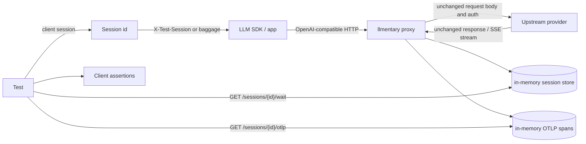

# Proxy reference

`llmentary` starts two HTTP servers:

- the proxy listener, which forwards SDK/provider traffic and records calls;
- the control listener, which exposes recorded sessions and in-memory OTLP spans.

The proxy does not translate request or response formats. It forwards the upstream
request body, response body, and streaming bytes unchanged, while recording a tee copy for
tests.

## How it works



The proxy forwards the provider protocol unchanged. It records a tee copy, parses
OpenAI-wire calls when it can, and leaves everything else as raw passthrough.

## CLI flags, environment, and config

There is no config file format in the current code. Configuration comes from environment
variables plus CLI flags.

| CLI flag | Environment | Default | Meaning |
|---|---|---|---|
| `--listen` | `LLMENTARY_LISTEN` | `:7777` | Proxy listen address. |
| `--control` | `LLMENTARY_CONTROL_LISTEN` | `127.0.0.1:7778` | Control API listen address. |
| `--control-token` | `LLMENTARY_CONTROL_TOKEN` | empty | Bearer token required by the control API when set. Also required when the control listener is non-loopback. |
| `--upstream` | `LLMENTARY_UPSTREAMS`, fallback `LLMENTARY_UPSTREAM` | `openai=https://api.openai.com/v1` | Upstream mapping. Repeat the flag or use comma-separated environment values. When omitted, the proxy logs `no upstream configured; defaulting to openai=https://api.openai.com/v1`. |
| `--tls` | none | `false` | Parsed by the CLI, but not wired to a TLS listener in the current code. |
| `--spec-validation` | `LLMENTARY_SPEC_VALIDATION` | `warn` | Request spec validation mode: `off`, `warn`, or `enforce`. Invalid values exit non-zero. |
| `--spec-profile` | `LLMENTARY_SPEC_PROFILE` | `relaxed` | Spec profile: `strict` (pinned spec + closed-world) or `relaxed` (strict plus `api/openai/relax-overlay.yaml`). |
| `--spec-validation-max-bytes` | `LLMENTARY_SPEC_VALIDATION_MAX_BYTES` | `8388608` | Maximum request body size to validate. Larger bodies are forwarded and marked `skipped_reason: body_too_large`. |
| `--spec-log-max` | `LLMENTARY_SPEC_LOG_MAX` | `5` | After the summary WARN, log at most this many per-finding WARN lines. `0` logs the summary only. |

With no `--upstream` and no `LLMENTARY_UPSTREAMS` / `LLMENTARY_UPSTREAM`, the proxy
defaults to `openai=https://api.openai.com/v1`. `GET /config` reports the effective
upstreams (names and sanitized URLs). An upstream whose host:port is the proxy listen
address (including `localhost`, `127.0.0.1`, `0.0.0.0`, and `[::1]` on the same port)
is refused at startup so the proxy cannot loop on itself.

```bash
llmentary \
  --listen 127.0.0.1:7777 \
  --control 127.0.0.1:7778
```

Equivalent explicit configuration, plus a second named Azure upstream:

```bash
llmentary \
  --listen 127.0.0.1:7777 \
  --control 127.0.0.1:7778 \
  --upstream openai=https://api.openai.com/v1 \
  --upstream azure=https://my-resource.openai.azure.com
```

Equivalent environment configuration:

```bash
export LLMENTARY_LISTEN=127.0.0.1:7777
export LLMENTARY_CONTROL_LISTEN=127.0.0.1:7778
export LLMENTARY_UPSTREAMS='openai=https://api.openai.com/v1,azure=https://my-resource.openai.azure.com'
llmentary
```

`--upstream` accepts either `name=https://host/base` or a bare URL. A bare URL is stored
under the name `default`. If the same name is configured more than once, the later value
wins.

## Named upstreams and path prefixes

Named upstreams are addressed with `/u/{name}/...` on the proxy listener. The rest of the
path is joined to the configured upstream base path.

```text
http://127.0.0.1:7777/u/openai/chat/completions
  -> https://api.openai.com/v1/chat/completions

http://127.0.0.1:7777/u/azure/openai/deployments/my-deployment/chat/completions?api-version=2024-10-21
  -> https://my-resource.openai.azure.com/openai/deployments/my-deployment/chat/completions?api-version=2024-10-21
```

Bare proxy paths are accepted only when exactly one upstream exists or when an upstream
named `default` exists:

```text
http://127.0.0.1:7777/v1/chat/completions
  -> https://api.openai.com/v1/chat/completions
```

That combination used to repeat the version segment. The join rule below overlaps
shared path prefixes, so both `https://api.openai.com` and `https://api.openai.com/v1`
work with both `{proxy}/v1` and `{proxy}/u/openai`.

With multiple upstreams and no `default`, a bare path returns `502 Bad Gateway` with
`bare proxy path requires exactly one upstream or a default upstream`.

## Path join

Joining the configured upstream base to the request path is proxy routing, not a rewrite
of the client's request body or headers. When the upstream base path ends with segments
that the request path starts with, those segments are used once:

| Upstream form | Client base URL | Final URL |
|---|---|---|
| `https://api.openai.com/v1` | `{proxy}/v1` | `https://api.openai.com/v1/chat/completions` |
| `https://api.openai.com/v1` | `{proxy}/u/openai` | `https://api.openai.com/v1/chat/completions` |
| `https://api.openai.com` | `{proxy}/v1` | `https://api.openai.com/v1/chat/completions` |
| `https://api.openai.com` | `{proxy}/u/openai/v1` | `https://api.openai.com/v1/chat/completions` |
| `https://openrouter.ai/api/v1` | `{proxy}/v1` | `https://openrouter.ai/api/v1/chat/completions` |
| `https://openrouter.ai/api/v1` | `{proxy}/u/openrouter` | `https://openrouter.ai/api/v1/chat/completions` |
| `https://my-resource.openai.azure.com/openai/v1` | `{proxy}/u/azure` | `https://my-resource.openai.azure.com/openai/v1/chat/completions` |
| `https://my-resource.openai.azure.com` | `{proxy}/u/azure/openai/deployments/my-dep/chat/completions` | `https://my-resource.openai.azure.com/openai/deployments/my-dep/chat/completions` |

A `/s/{session}` prefix (session attribution) is stripped before this join; remaining
`/u/{name}` is stripped the same way.

## API type detection

The parser chooses an API family from the upstream method and final upstream path:

| Condition | `api_family` |
|---|---|
| `POST` and path ends with `/chat/completions` | `openai.chat` |
| `POST` and path ends with `/responses` | `openai.responses` |
| Anything else | `passthrough` |

Passthrough calls are still recorded, including headers, raw request/response bytes,
status, timings, and spans. They are not parsed into tool calls, usage, or provider
finish reasons.

Azure `api-version` is extracted from the upstream query string. Azure deployment is
extracted from `/deployments/{deployment}/...` path segments.

## Session tagging

Each call is stored in one session:

1. `X-Test-Session: <id>` wins.
2. If the header is absent, W3C `baggage` is scanned for one of:
   - `llmentary.session.id`
   - `llmentary.session`
   - `test-session`
   - `x-test-session`
3. If no tag is present, the call lands in the `default` session.

The Go client in [llmentary-go](https://github.com/barzoj-co/llmentary-go)
creates a random session id and can inject `X-Test-Session` through `lm.HTTPClient()`.

## Header forwarding and stripping

Before forwarding upstream, the proxy:

- removes `X-Test-Session`;
- removes any `baggage` member whose key starts with `llmentary.`;
- preserves non-`llmentary.*` baggage members;
- injects W3C trace context for the proxy CLIENT span;
- sets `Accept-Encoding: identity`;
- removes hop-by-hop headers:
  `Connection`, `Proxy-Connection`, `Keep-Alive`, `Proxy-Authenticate`,
  `Proxy-Authorization`, `Te`, `Trailer`, `Transfer-Encoding`, and `Upgrade`.

Auth headers are forwarded to the provider. They are only redacted in the recorded copy.

## SSE passthrough semantics

Streaming responses are passed through byte-for-byte to the SDK client. The proxy flushes
after each copied chunk when the response writer supports flushing.

For recording:

- `Content-Type: text/event-stream` is parsed as SSE.
- If the SSE response is not gzip-encoded, events are recorded incrementally as chunks
  arrive.
- If the upstream still returns gzip, the client receives the gzip bytes unchanged, while
  the recorded tee copy is decompressed for parsing. Gzip is stored decompressed
  because `raw_response` is the parse input (and the E6 hash subject), not a
  wire-capture of the HTTP envelope. See `docs/data-model.md` § Gzip and
  raw-byte hashes.
- A Chat Completions stream is considered complete when a `data: [DONE]` event is seen.
- A Responses stream is considered complete when a terminal `response.completed`,
  `response.failed`, or `response.incomplete` event is parsed.
- SSE comment lines, including OpenRouter keep-alive comments, are recorded as comments
  and ignored by the normalizer.
- If no terminal marker/event is seen, `normalized.stream_truncated` is set.

## Secret redaction

Recorded headers redact these names by replacing values with `sha256:<16 hex chars>`:

- `Authorization`
- `api-key`
- `x-api-key`
- `x-goog-api-key`
- `Cookie`
- `Set-Cookie`

Recorded upstream URLs redact these query parameters the same way:

- `key`
- `api_key`
- `sig`
- `signature`

Raw request and response bodies are stored for test assertions and are not redacted by the
current implementation. Treat the local control API as sensitive.

## Control API bind and token security

The default control address is loopback-only: `127.0.0.1:7778`.

If `--control-token` or `LLMENTARY_CONTROL_TOKEN` is set, every control API request must
send:

```http
Authorization: Bearer <token>
```

If the control address is non-loopback, validation fails unless a control token is set.
`localhost` and loopback IP addresses are accepted as loopback. A hostless bind such as
`:7778` is treated as non-loopback and therefore requires a token.

## Control endpoints

All endpoints are on the control listener, not the proxy listener.

### `GET /healthz`

Returns `200 OK` and a plain text body.

```bash
curl -i http://127.0.0.1:7778/healthz
```

```http
HTTP/1.1 200 OK

ok
```

### `GET /sessions/{id}`

Returns the current session immediately.

```bash
curl http://127.0.0.1:7778/sessions/test-1
```

```json
{
  "id": "test-1",
  "calls": [
    {
      "id": "call_1",
      "session_id": "test-1",
      "session_source": "header",
      "seq": 1,
      "started_at": "2026-10-18T08:54:00Z",
      "ended_at": "2026-10-18T08:54:01Z",
      "latency_ms": 742,
      "provider": "openai",
      "api_family": "openai.chat",
      "upstream": {
        "method": "POST",
        "url": "https://api.openai.com/v1/chat/completions"
      },
      "request": {
        "headers": {
          "Authorization": ["sha256:0123456789abcdef"]
        }
      },
      "response": {
        "headers": {
          "Content-Type": ["application/json"]
        }
      },
      "stream": false,
      "http_status": 200,
      "normalized": {
        "derived_version": 3,
        "model": {
          "requested": "gpt-4.1-mini",
          "returned": "gpt-4.1-mini"
        },
        "finish_reason": "stop"
      }
    }
  ]
}
```

`raw_request`, `raw_response`, and `sse_events[].data` are Go `[]byte` fields and appear
as base64 strings in JSON.

### `GET /sessions/{id}/wait`

Waits until the session has no active calls and stays unchanged for a quiet period.

Query parameters:

| Name | Default | Meaning |
|---|---|---|
| `quiet` | `500ms` | Required quiet period after the last version change. Parsed by Go `time.ParseDuration`. |
| `timeout` | `30s` | Maximum wait before returning `504 Gateway Timeout`. Parsed by Go `time.ParseDuration`. |

```bash
curl 'http://127.0.0.1:7778/sessions/test-1/wait?quiet=100ms&timeout=5s'
```

Response body is the same session JSON shape as `GET /sessions/{id}`.

### `GET /sessions/{id}/otlp`

Returns OTLP/JSON trace data for spans recorded in the session.

```bash
curl http://127.0.0.1:7778/sessions/test-1/otlp
```

```json
{
  "resourceSpans": [
    {
      "resource": {
        "attributes": [
          {
            "key": "service.name",
            "value": { "stringValue": "llmentary-proxy" }
          }
        ]
      },
      "scopeSpans": [
        {
          "scope": {
            "name": "github.com/barzoj-co/llmentary/proxy",
            "version": "0.1.0-dev"
          },
          "spans": []
        }
      ]
    }
  ]
}
```

See [OTel GenAI mapping](otel.md) for span attributes.

### `DELETE /sessions/{id}`

Deletes the session calls and OTLP spans.

```bash
curl -i -X DELETE http://127.0.0.1:7778/sessions/test-1
```

```http
HTTP/1.1 204 No Content
```

### Unsupported methods

Unsupported methods under `/sessions/{id}` return `405 Method Not Allowed` with:

```http
Allow: GET, DELETE
```

### `GET /config`

Returns the effective spec-validation settings so clients can tell "validated, clean" from "not validated":

```json
{"spec_validation":"warn","spec_profile":"relaxed","spec_sha":"…","schema_subset_retrieved":"2026-10-18","upstreams":{"openai":"https://api.openai.com/v1"}}
```

## Spec validation

Raw Chat Completions and Responses request bytes are validated against the pinned OpenAI sub-spec after capture and before the typed handler. The original bytes are always forwarded (or, in `enforce`, not forwarded). Response bytes are validated report-only after they have been flushed to the client.

Where findings show up: trace (`normalized.spec_violations`), proxy log (WARN), client assertions.

| Field | What it is | Empty vs absent |
|---|---|---|
| `validation` | Metadata: was the call checked, and how (`mode`, `profile`, `spec_sha`, checked flags, `skipped_reason`). Not a list of problems. | Absent when validation was not run (`off`). Present in `warn`/`enforce` even when the call is clean. |
| `spec_violations` | Findings from the spec validator. | `[]` means checked and clean. Absent means not checked. |
| `ignored_fields` | Silently ignored request content (unknown schema keywords, unknown request fields, strict fallback). | Same empty-vs-absent rule as `spec_violations`. |

In `warn` and `enforce`, after the call finishes the proxy writes one WARN summary per finding category (`msg="spec violations"` and/or `msg="ignored fields"`), then one WARN line per finding. `--spec-log-max` (default 5; `0` is summaries only) is a single per-call budget shared across both categories. Detail lines include `call_id`, pointers, keywords, kinds, and schema messages. Format-keyword messages are replaced with `format validation failed`. Value-bearing keywords (`pattern`, `minimum`, `maximum`, `exclusiveMinimum`, `exclusiveMaximum`, `multipleOf`) use `schema validation failed`, so rejected field values are not logged. Summaries include `session` (the recorded session id, as in `proxy request` / `proxy response`). They never include request bodies, field values, or `Authorization` / cookie / api-key header values. Enforce rejections use the same WARN lines.

| Mode | Behavior |
|---|---|
| `off` | No compile, no run. `validation`, `spec_violations`, and `ignored_fields` are absent from the trace. |
| `warn` (default) | Record findings and forward byte-for-byte. Arrays are always present (`[]` when clean). |
| `enforce` | If there is a request-side `spec_violation` or a `reject_in_enforce` ignored field, the proxy answers a local 400 and does **not** call the upstream. Response-side findings never reject. |

Local enforce 400:

```http
HTTP/1.1 400 Bad Request
Content-Type: application/json
X-Llmentary-Rejected: spec_violation

{"error":{"message":"llmentary: request rejected (profile=relaxed): …","type":"invalid_request_error","param":"…","code":"llmentary_spec_violation"}}
```

`code` is `llmentary_spec_violation` or `llmentary_ignored_field`. Streamed requests still get a JSON 400, not SSE.

Profiles:

- `strict`: pinned spec plus the closed-world transform (`unevaluatedProperties:false` on complete object schemas; allOf fragments stay open so compositions still work; free-form payloads such as tool `parameters` stay open).
- `relaxed`: `strict` plus `api/openai/relax-overlay.yaml`. Overlay entries are live-verified.

**D5 (reworded).** In `--spec-validation=off` and `warn` modes, a request body that does not decode into the generated type (malformed JSON, valid JSON with a field of unknown type, trailing data) is **not** answered by the proxy: it goes upstream byte-for-byte, the client gets the upstream response, and `parser_warnings` contains the reason; in `warn`, `spec_violations` also records it. In `enforce` mode, and only for requests, the proxy answers a local OpenAI-shaped 400 (`code: llmentary_spec_violation` or `llmentary_ignored_field`) **without calling the upstream** if there is at least one request-side spec violation or reject-class ignored field. Responses are never rejected or altered in any mode.

## Features

- Reverse proxy binary: `cmd/llmentary`.
- Named upstreams, including `/u/{name}/...` routing and bare-path routing for a single
  upstream or a `default` upstream.
- OpenAI Chat Completions parser for streaming and non-streaming responses.
- OpenAI Responses parser for streaming and non-streaming responses.
- Azure OpenAI paths with dated `api-version` query strings, deployment extraction, and
  `/openai/v1`-style OpenAI-compatible URLs.
- OpenRouter/OpenAI-compatible stream tolerance, including keep-alive comments and final
  usage chunks.
- Raw passthrough recording for unrecognized APIs.
- Per-test sessions via `X-Test-Session` or W3C baggage.
- Control API for health, session fetch, wait-until-quiet, OTLP/JSON export, and delete.
- Secret redaction in recorded headers and selected URL query parameters.
- Clients (separate repos) with trace queries and assertions for tools, JSON args, retries,
  errors, usage, response content, latency, and TTFT.
- One in-memory OTel CLIENT span per proxied attempt, using stable HTTP attributes plus
  pinned GenAI attributes.

## Status and roadmap

The session store and OTLP span store are in memory. Clients live in their own
repos. Planned in later versions of the proxy:

- Anthropic Messages parsing in v2.
- External OTLP export and stricter content-capture controls.
- Record/replay cassettes, fault injection, packaging polish, and local TLS.

The current `--tls` flag is parsed by the CLI but is not wired to any TLS listener.
